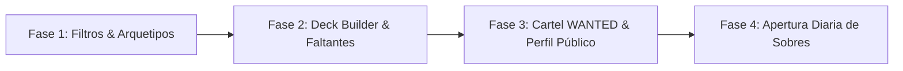

# 🏴‍☠️ GRAND LINE VAULT — BENCHMARK COMPETITIVO, GAPS & KILLER FEATURES

> **Subpágina de Notion:** Análisis estratégico de competidores, nuevas funciones a implementar y propuesta de valor única para maximizar visitas, retención y viralidad.  
> **Proyecto:** Grand Line Vault (OPTCG Tracker & Vault X Binder)  
> **Creador:** Killian Torrell ([killiantr.vercel.app](https://killiantr.vercel.app))  
> **Fecha:** Octubre 2026 • **Estado:** 📋 Planificación & Backlog Estratégico  

---

## 📌 1. RADIOGRAFÍA DE COMPETIDORES DIRECTOS

### A. OPlayTCG (`https://oplaytcg.com/es`) — "El Simulador Competitivo Web"
* **Enfoque Principal:** Diseñado como el *Pokémon Showdown* o *DuelingBook* de One Piece TCG. Prioriza el juego online en tiempo real y el análisis competitivo.
* **Módulos y Funciones Clave:**
  1. **Simulador Online en Navegador (Coliseo):** Partidas 1v1 con motor determinista fiel a las reglas oficiales, modo Ranked con ELO, partidas privadas con amigos y repeticiones grabadas.
  2. **Biblioteca de Cartas Universal:** Más de 3.000 cartas únicas y 33.000 variantes/reimpresiones en 7 idiomas.
  3. **Filtro por Arquetipos / Rasgos (Traits):** Clasificación por tripulaciones y facciones (*Mugiwaras*, *Marina*, *Piratas de Barbablanca*, *CP9*, *Wano*, *Revolucionarios*, etc.).
  4. **Deck Builder Oficial:** Constructor de barajas con validación de reglas de Bandai (50 cartas + 1 líder + 10 DON!!), comprobación de colores de líder y curvas de coste.
  5. **Meta Stats & Tier Lists:** Estadísticas de victorias de líderes en torneos, análisis de porcentaje de victorias de salir primero vs. segundo.
  6. **Spoilers de Japón:** Cartas reveladas de próximas expansiones antes de su llegada a Occidente.
  7. **Changelog y Botón de Bug Report Flotante:** Historial organizado y feedback directo de usuarios.

---

### B. TCG Vault UK (`https://tcgv.co.uk`) — "La Base de Datos de Mercado & Tracker"
* **Enfoque Principal:** Orientado a coleccionistas e inversores del Reino Unido y jugadores locales. Prioriza el control de precios, inventario y compra de producto.
* **Módulos y Funciones Clave:**
  1. **Collection Tracker ("My Binder"):** Registro de cartas conseguidas y cálculo porcentual de completitud de colecciones.
  2. **Guía de Precios de Mercado en Vivo:** Cotizaciones actualizadas de cartas individuales y producto sellado mediante TCGPlayer y Cardmarket.
  3. **Stock Tracker de Tiendas Retail:** Monitorización en vivo de disponibilidad de cajas selladas en tiendas especializadas del Reino Unido a precio recomendado (RRP) para combatir la especulación.
  4. **Deck Builder con Análisis de Faltantes ("Missing Cards Calculator"):** Te permite armar o clonar un mazo del meta, y el sistema calcula exactamente qué cartas te faltan en tu álbum y el coste exacto en euros/libras para terminártelo.
  5. **Seguimiento de Producto Sellado:** Gestión de cajas precintadas (*Booster Boxes*, *Displays*, latas de coleccionista).

---

## ⚖️ 2. MATRIZ COMPARATIVA DE MERCADO

| Característica / Módulo | OPlayTCG | TCG Vault UK | Grand Line Vault (Nosotros) |
| :--- | :---: | :---: | :---: |
| **Experiencia Táctil de Álbum Físico (Vault X)** | ❌ No (Tablas planas) | ❌ No (Cuadrícula básica) | **⭐ Sí (Única en el mercado)** |
| **Álbum Libre Personalizado ("Mis Carpetas" + Drag & Drop)** | ❌ No | ❌ No | **⭐ Sí (Exclusiva)** |
| **Efectos Hápticos de Audio (Paso de página / Snap)** | ❌ No | ❌ No | **⭐ Sí (Exclusiva)** |
| **Perfil Pirata con Rangos, Cooldown y Avatar 300x300** | ❌ No | ❌ No | **⭐ Sí (Gamificación propia)** |
| **Tablón de Intercambios P2P (TradeBoard)** | ❌ No | ❌ No | **⭐ Sí (Integrado)** |
| **Subpágina Changelog Dedicada & Botón Reporte Bug** | ✅ Sí | ❌ No | **✅ Sí (Implementado v0.6.4)** |
| **Catálogo Masivo de Cartas & Variantes** | ✅ 3.000+ cartas | ✅ 5.000+ cartas | ⚠️ 105 cartas oficiales verificadas |
| **Filtro por Arquetipos / Familias de Tripulación** | ✅ Sí | ✅ Sí | ❌ Pendiente |
| **Constructor de Mazos (Deck Builder)** | ✅ Sí | ✅ Sí | ❌ Pendiente |
| **Calculadora de Cartas Faltantes para Mazos** | ❌ No | ✅ Sí | ❌ Pendiente |
| **Seguimiento de Producto Sellado (Booster Boxes)** | ❌ No | ✅ Sí | ❌ Pendiente |
| **Sección de Spoilers / Filtraciones de Japón** | ✅ Sí | ❌ No | ❌ Pendiente |
| **Simulador de Apertura de Sobres (Pack Opening)** | ❌ No | ❌ No | ❌ Ninguna lo tiene |

---

## 🛠️ 3. GAPS A IMPLEMENTAR (QUÉ PODEMOS IMPORTAR)

### 1. Ingestión Masiva & Filtro por Arquetipos / Familias *(Inspirado en OPlayTCG)*
* **Qué es:** Añadir un selector de facciones y familias en el catálogo: *Piratas de Sombrero de Paja*, *La Marina*, *Los Cuatro Emperadores*, *Supernovas*, *Los Siete Guerreros del Mar*, *Dressrosa*, *Revolucionarios*, *Wano Kuni*, etc.
* **Valor:** En One Piece TCG las sinergias van por familias. Los jugadores buscan cartas por rasgo para montar sus estrategias.

### 2. Deck Builder Conectado al Álbum Virtual *(Inspirado en TCG Vault)*
* **Qué es:** Una herramienta donde el usuario diseña o pega una lista de cartas de un mazo competitivo (ej. importada de OPTCG Sim).
* **La gran ventaja:** La web cruza el mazo con las cartas del archivador del usuario y le muestra:
  * 🟢 **Cartas que ya posee** (iluminadas en verde).
  * 🔴 **Cartas que le faltan** (conteo de copias necesarias).
  * 💶 **Presupuesto estimado** necesario para completar el mazo en **CardTrader** en un solo clic.

### 3. Seguimiento de Cajas y Producto Sellado *(Inspirado en TCG Vault)*
* **Qué es:** Pestaña especial en el archivador para inventariar cajas precintadas (*Booster Boxes* de OP-01, OP-05, OP-09, barajas de inicio ST, etc.) con su cotización actual.
* **Valor:** Atrae al coleccionista de producto sellado y a tiendas locales.

### 4. Sección de Spoilers y Próximos Sets *(Inspirado en OPlayTCG)*
* **Qué es:** Espacio con las cartas recién mostradas en Japón con traducción y cuenta atrás oficial hasta el lanzamiento occidental.

---

## 👑 4. PROPUESTA DE VALOR ÚNICA & "KILLER FEATURES"
### *¿Cómo diferenciarnos del resto para disparar visitas, engagement y viralidad?*

Ni OPlayTCG ni TCG Vault aprovechan **la emoción y el coleccionismo temático de One Piece**. Son herramientas frías de números o combate. Grand Line Vault tiene la mejor experiencia visual interactiva del mundo (el álbum de lujo físico).

Para conseguir viralidad masiva en Twitter/X, Instagram, TikTok y Discord, estas son las dos funciones diferenciadoras exclusivas:

---

### 🔥 KILLER FEATURE 1: "El Cartel WANTED y Álbum Público Compartible"
> **Concepto:** Cada usuario cuenta con una URL pública propia (ejemplo: `grandlinevault.com/u/Killian_TR`).

1. **Cartel Oficial de Recompensa (WANTED Bounty):**
   * La web genera automáticamente un cartel de Se Busca pirata con la foto de perfil del usuario, su nombre y una **Recompensa en Berries (฿)** calculada por un algoritmo dinámico:
     * *+10.000.000 ฿ por cada carta Manga Rare.*
     * *+5.000.000 ฿ por cada Secreta (SEC).*
     * *+100.000.000 ฿ por completar una expansión al 100%.*
     * *Multiplicador según el valor total en euros (€) del archivador.*
2. **Modo Visitante — Hojear el Archivador:**
   * Al hacer clic en el enlace, cualquier amigo o miembro de la comunidad puede **pasar físicamente las páginas de tu álbum virtual Vault X**, viendo tus cartas conseguidas, brillos holográficos y cartas faltantes.
3. **Por qué arrasa en visitas:**
   * A los coleccionistas les fascina presumir de sus cartas. En vez de fotos estáticas en redes, compartirán su enlace de Grand Line Vault: *"¡Mi recompensa ha alcanzado 1.500.000.000 Berries! Pasa las páginas de mi archivador para ver mis joyas"*.

---

### 🎲 KILLER FEATURE 2: "Simulador de Apertura de Sobres (Daily Booster Pack Opening)"
> **Concepto:** Gamificación diaria dentro de la web.

* El usuario puede abrir gratis **1 sobre virtual al día** de cualquier expansión oficial (OP-01, OP-05, OP-09...) con animación de desprecintar el envoltorio.
* Ratios de probabilidades idénticos a los de Bandai (posibilidad de abrir cartas Manga Rares, Secretas o Paralelas).
* Las cartas abiertas se pueden guardar en tu álbum personal con confeti celebratorio.
* **Por qué funciona:** Crea un hábito diario que genera **visitas recurrentes todos los días**.

---

## 🚀 5. HOJA DE RUTA DE DESARROLLO (ROADMAP POR FASES)

### 🎯 Fase 1 — Filtros de Familia / Arquetipo y Catálogo Masivo
* [ ] Extender filtros de `CardCatalog.jsx` con selector de Familias (*Straw Hat Crew*, *Navy*, *Four Emperors*, *Wano*, etc.).
* [ ] Ingestión masiva de nuevas expansiones (EB-01 Memorial Collection, PRB-01, nuevas barajas ST).

### 🎯 Fase 2 — Deck Builder Conectado a la Colección
* [ ] Crear interfaz de construcción de mazos (`DeckBuilder.jsx`).
* [ ] Importación y exportación de listas en formato OPTCG Sim.
* [ ] Cruce inteligente de datos: cartas en posesión vs. cartas faltantes.
* [ ] Cálculo del presupuesto necesario y botón de compra directa en CardTrader.

### 🎯 Fase 3 — Cartel WANTED y Showcase Público Compartible (Viralidad)
* [ ] Endpoint / ruta de perfil público de usuario (`/u/:username`).
* [ ] Generación automática de cartel de Se Busca (WANTED) con recompensa en Berries (฿).
* [ ] Modo de visualización de álbum en modo solo lectura para visitantes.
* [ ] Botones para compartir en X/Twitter, WhatsApp, Discord y Telegram con vista previa Open Graph.

### 🎯 Fase 4 — Gamificación y Producto Sellado
* [ ] Mini-juego de apertura de sobres diaria gratuita (*Daily Pack Opening*).
* [ ] Módulo de inventario para cajas selladas (*Booster Boxes* y *Displays*).

---

## 📝 6. CHECKLIST DE ACCIÓN INMEDIATA PARA NOTION

- [ ] Crear subpágina en Notion titulada: `Grand Line Vault — Benchmarking, Roadmap & Killer Features`.
- [ ] Pegar este documento completo en la nueva subpágina.
- [ ] Asignar prioridades según el tiempo de desarrollo disponible.
- [ ] Vincular las tareas a la tabla Kanban principal de desarrollo del proyecto.
